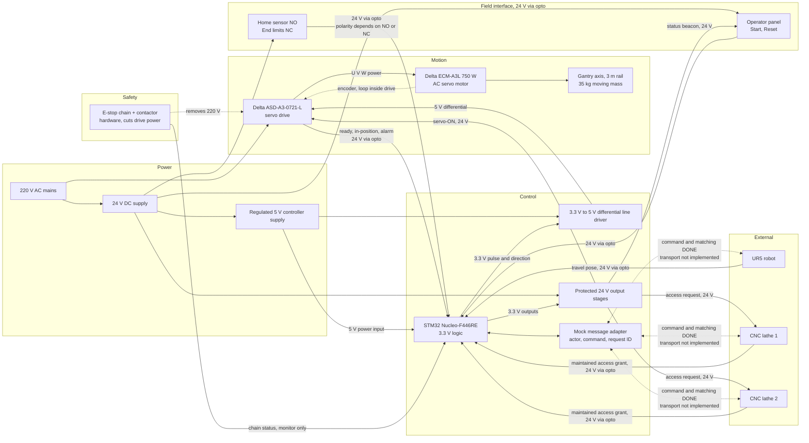

# System block diagram — Mermaid source

Updated source based on the supplied overview. Page 1 of circuit.pdf retains
the overview image; page 2 gives the electrical and communication qualifications.

The E-stop block is conceptual independent hardware, not a validated stop design.
No direct 24 V connection to MCU pins is intended. Field/input isolation does not
establish whole-system isolation; power, output and communication interfaces need
a defined grounding and isolation design.
