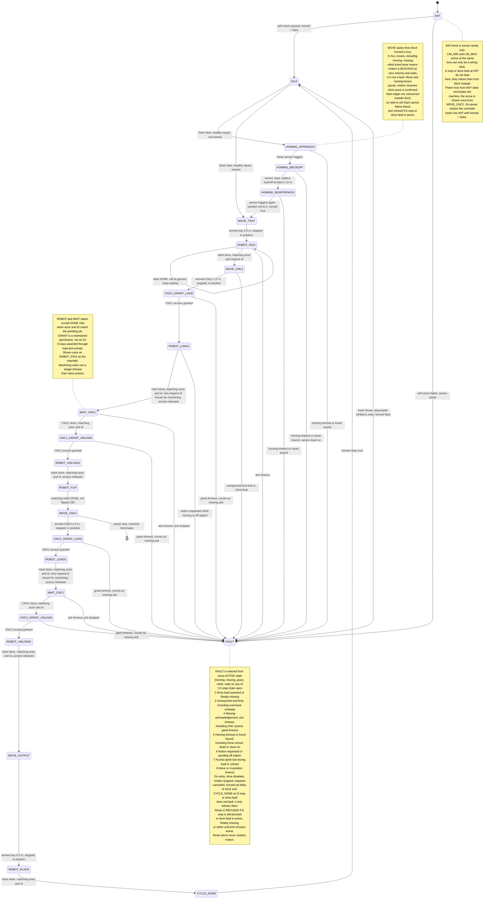

# State machine — final version

24 states. The C enum in `code/main.c` uses these exact names.
Conventions: one representative arrow is drawn where a rule applies to many
states (stale DONE, power loss); the notes state the rule in full.

The PC run returns from CYCLE_DONE to IDLE, then exits after checking its outputs.
FAULT cancels local mock timers; stopping real external machines requires a separate
validated interface. Power-on must also resynchronize the external message session.
